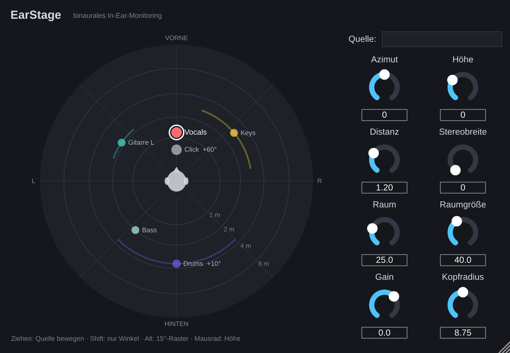

# EarStage – binaurales In-Ear-Monitoring

Ein VST3/AU-Plugin für Ableton Live, das jeden Kanal deines In-Ear-Mixes an einen
eigenen Ort im Raum um deinen Kopf setzt – angelehnt an die Idee von KLANG:fabrik.
Statt dass alles in der Mitte deines Kopfes klebt, stehen Gesang, Gitarre, Keys,
Drums usw. an unterschiedlichen Positionen. Dadurch lassen sie sich viel leichter
auseinanderhören, und du brauchst oft weniger Gesamtlautstärke.



## Was das Plugin macht

Pro Quelle (bei Stereospuren zwei Quellen, gespreizt um die *Stereobreite*):

| Baustein | Wirkung |
| --- | --- |
| **ITD** (Laufzeitunterschied, Woodworth-Modell) | Schall erreicht das abgewandte Ohr bis zu ~0.7 ms später |
| **Kopfschatten** (Brown & Duda) | Höhen werden am abgewandten Ohr gedämpft (bis ~13 dB ILD) |
| **Ohrmuschel-Cues** | Höhen-Absenkung für Quellen hinter dir, wandernde Kerbe für die Höhe |
| **Distanz** | Pegel, Luftdämpfung und Verhältnis Direktschall/Raum |
| **Raum** | frühe Reflexionen + kurzer Nachhall → der Mix steht *vor* dir statt *im* Kopf |

Das Plugin hat **keine zusätzliche Latenz** (keine FFT-Faltung, kein Lookahead) und
braucht nur wenig CPU – auch 16+ Instanzen sind auf einem M2 kein Problem.

**Gemeinsame Bühne:** Alle EarStage-Instanzen im Set sehen sich gegenseitig. Jedes
Plugin-Fenster zeigt die komplette Bühne mit allen Kanälen (Name und Farbe kommen
automatisch von der Ableton-Spur), und du kannst jede Quelle aus jedem Fenster heraus
verschieben.

Bedienung im Bühnenfenster:
- **Ziehen** – Quelle bewegen (Winkel + Distanz); Klick ins Leere setzt die eigene Quelle dorthin
- **Shift** + Ziehen – nur den Winkel ändern
- **Alt** + Ziehen – auf 15°-Schritte einrasten
- **Mausrad** über einer Quelle – Höhe (Elevation)
- Feld **Quelle** – eigener Anzeigename (leer = Spurname)

Alle Parameter sind in Ableton automatisierbar bzw. per MIDI mappbar.

## Installation (Mac)

1. Auf GitHub unter **Actions → „EarStage Plugin bauen“** den letzten erfolgreichen
   Lauf öffnen und unten das Artefakt **EarStage-macOS** herunterladen.
2. Entpacken und kopieren:
   - `EarStage.vst3` → `~/Library/Audio/Plug-Ins/VST3/`
   - `EarStage.component` → `~/Library/Audio/Plug-Ins/Components/`
3. Das Plugin ist nicht bei Apple notarisiert. Darum einmal im Terminal:
   ```
   xattr -dr com.apple.quarantine ~/Library/Audio/Plug-Ins/VST3/EarStage.vst3
   xattr -dr com.apple.quarantine ~/Library/Audio/Plug-Ins/Components/EarStage.component
   ```
4. Ableton neu starten → Einstellungen → Plug-Ins → ggf. „Neu scannen“.
   EarStage liegt unter *Bastelkram*.

Selbst bauen: `cmake -S binaural-iem -B build -G Xcode && cmake --build build --config Release`

## Setup mit MR18 + Ableton

Die Idee: Die MR18 schickt alle Eingänge per USB in Ableton, Ableton baut daraus
deinen binauralen IEM-Mix und schickt ihn per USB zurück in die MR18, die ihn auf
deinen In-Ear-Ausgang legt.

**1. Audio-Interface in Ableton**
- Einstellungen → Audio: MR18 als Ein- und Ausgabegerät
- **Samplerate 48 kHz**, Puffergröße **64 oder 128 Samples**
  (bei 64 Samples ca. 3–4 ms Gesamtlatenz – fürs Monitoring gut verträglich;
  bei Knacksern auf 128 gehen)
- Unter *Eingangs-Konfiguration* die benötigten MR18-Kanäle (Mono-Paare oder Stereo) aktivieren

**2. MR18 (X AIR Edit) – Routing**
- *In/Out → USB Sends:* die Kanäle 1–16 **pre-fader / pre-EQ** (je nach Wunsch)
  auf USB 1–16 legen, damit Ableton die rohen Signale bekommt
- *USB Returns:* Ableton-Ausgang z. B. USB 17/18 → **Aux-Return** bzw. als Quelle
  auf den Bus, der deinen In-Ear-Sender/Kopfhörer speist
- Den IEM-Bus so einstellen, dass **nur** dieser USB-Return drauf ist
  (sonst hörst du die Kanäle doppelt – einmal trocken, einmal binaural → Kammfilter)

**3. Ableton-Set**
- Pro Eingang eine Audiospur, Monitor auf **In**
- Auf jede Spur **EarStage** als (einziges oder letztes) Effekt-Plugin
- Spuren auf den Master oder eine Gruppe „IEM“, Ausgang → USB 17/18 der MR18
- Startpositionen, die sich bewährt haben:

  | Quelle | Azimut | Distanz | Hinweis |
  | --- | --- | --- | --- |
  | eigene Stimme | 0° | 0.8–1.2 m | vorne, nah |
  | Lead-Vocals | 0° bis ±15° | 1.2 m | vorne |
  | Gitarren | ±45–60° | 2 m | links/rechts gespreizt |
  | Keys | ±30–50° | 2.5 m | Stereobreite 40–60° |
  | Drums (Overheads) | 180° | 3 m | Stereobreite 90°, Höhe +10° |
  | Kick/Snare | 180° | 2.5 m | |
  | Bass | ±120–150° | 2 m | |
  | Click | 0° | 0.6 m | Höhe +60°, Raum 0 % |

  Faustregel: das, was du am wichtigsten hörst, nach vorne und nah; Rhythmus-Fundament
  nach hinten. Dinge, die sich frequenzmäßig überlappen (z. B. Gitarre/Keys), auf
  gegenüberliegende Seiten.

**4. Raum**
- *Raum* 15–30 % und *Raumgröße* ~40 % helfen der Externalisierung (Mix wirkt „draußen“).
- Click und eigene Stimme eher trocken (*Raum* 0–10 %), damit sie präzise bleiben.
- *Kopfradius*: 8.75 cm ist Durchschnitt. Wenn links/rechts zu „breit“ oder zu „schmal“
  wirkt, hier nachjustieren.

### Und das UA Sound City Studio?

Die EarStage-Räume sind bewusst klein und neutral. Wenn du einen schöneren gemeinsamen
Raum willst: einen **Return-Track mit Sound City Studio** (nur Raum, kurz) anlegen und von
den Spuren ein wenig hinschicken (Sends **post**-EarStage). Dann bei EarStage *Raum*
etwas zurücknehmen. Wichtig: Der Send-Pegel klein halten, sonst verwischt der diffuse
Stereo-Hall wieder die Ortung.

## Grenzen & Ideen für später

- Das HRTF-Modell ist **parametrisch** (kein gemessener Kunstkopf). Das klingt neutraler
  und hat null Latenz, Vorne/Hinten-Unterscheidung ist aber schwächer als mit gemessenen
  HRTFs. Eine Erweiterung mit SOFA-Dateien (z. B. personalisierte HRTFs) wäre möglich.
- Kein Head-Tracking (die Bühne dreht sich mit dem Kopf mit – auf der Bühne meist gewollt).
- Die gemeinsame Bühne funktioniert, solange alle Instanzen im selben Prozess laufen
  (in Ableton Standard).

## Entwicklung

```
cmake -S binaural-iem -B build -DCMAKE_BUILD_TYPE=Release
cmake --build build
./build/engine_test
```

Struktur:
- `Source/BinauralEngine.h` – DSP (ohne JUCE, einzeln testbar)
- `Source/PluginProcessor.*` – Parameter, Zustand, Spurname
- `Source/PluginEditor.*` – Bühnen-GUI
- `Source/StageRegistry.h` – gemeinsame Liste aller Instanzen
- `tests/engine_test.cpp` – Plausibilitätstests (ITD, ILD, Symmetrie, Stabilität)
